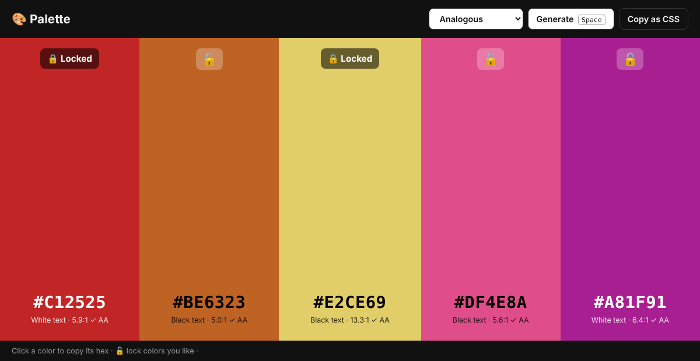
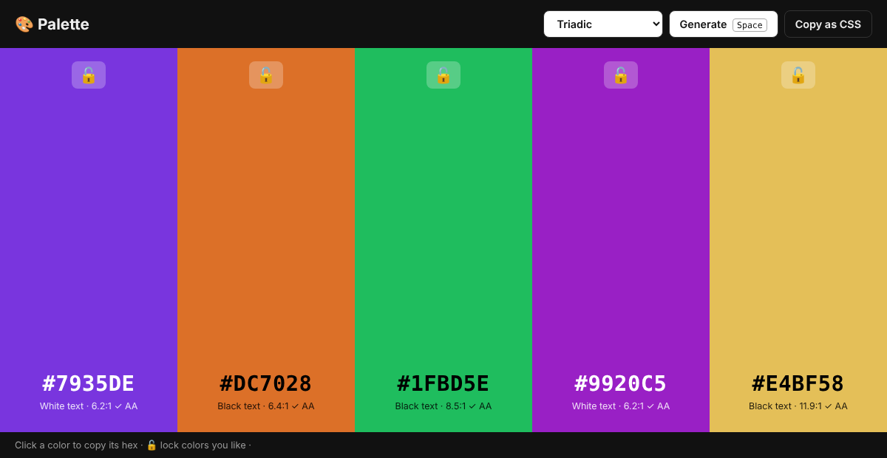

# 🎨 Palette: Color Palette Generator

Generate harmonious 5-color palettes with one key press. Lock the colors you like, copy hex codes, and check that text on each color is readable.
Plain HTML, CSS and JavaScript, with no frameworks and no build step.




## Features

- **Space** generates a new palette
- **4 harmony modes:** analogous, complementary, triadic, monochrome
- **Lock** colors to keep them; the new colors are built *around* the locked one, so the palette stays harmonious
- **Click** a color to copy its hex code
- **Copy as CSS** exports `:root { --color-1: … }` variables
- **Accessibility check:** shows white or black text, whichever is more readable, with its WCAG contrast ratio (✓ AA means 4.5:1 or better)

## Run it

Open `index.html` in your browser. Run the tests with:

```bash
node test.js
```

## How it works

- **Color wheel math:** each palette starts from a base *hue* (0–360°). Each harmony mode is a set of offsets on the wheel, for example triadic is `0°, 120°, 240°`. Colors are built in HSL (hue, saturation, lightness) and converted to hex.
- **Locking:** if a color is locked, its hue is read back from its hex code and used to work out the base hue, so new colors fit with it.
- **Contrast:** uses the WCAG formula. Each color's *relative luminance* gives the contrast ratio `(L1 + 0.05) / (L2 + 0.05)`, from 1:1 up to 21:1 for black on white.

## Files

```
index.html   # layout
style.css    # styling
color.js     # color math (no DOM, so it can be tested in Node)
app.js       # UI: render, lock, copy, keyboard
test.js      # 11 tests
```

## License

MIT
